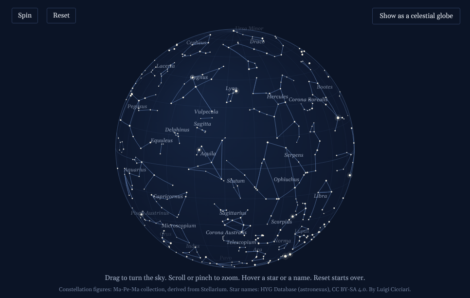

# The Sky Above You: constellation globe

An interactive celestial globe of the 88 constellations, built to sit inside the Tableau Public dashboard **[The Sky Above You](https://public.tableau.com/app/profile/luigi.cicciari)**. It also works on its own.

**Live page:** https://luigicicciari.github.io/constellation-globe/

## What it does

- Turns slowly on load, and stops as soon as you touch it. Visitors who have reduced motion turned on get no spin.
- Drag to turn the sky, scroll or pinch to zoom, and hover a star or a constellation name for details.
- **Reset** (or the Esc key) clears the highlighted constellation and returns to the starting view.
- **Show as a celestial globe** switches between the sky as seen from Earth and the mirror view printed on antique brass globes.

## URL settings

The page reads a few settings from its address. Tableau sets them with URL actions, but you can type them yourself.

| Setting | Example | What it does |
|---|---|---|
| `focus` | `focus=Ori` | Turns the globe to that constellation and outlines it in gold. Uses the IAU three-letter abbreviation. |
| `lat` | `lat=32.7` | Your latitude, from −90 to 90. Dims the sky that never rises there and rings the stars that never set. |
| `place` | `place=San%20Diego` | The name shown in the labels and key. Without it, the latitude is shown instead, for example "32.7° N". |
| `month` | `month=1` | 1 to 12. Brightens the constellations best seen that month. |
| `embed` | `embed=1` | Hides the page's credit line, for use inside a dashboard that has its own footer. |

Example: [`?focus=Cru&lat=-33.9&place=Sydney&month=5`](https://luigicicciari.github.io/constellation-globe/?focus=Cru&lat=-33.9&place=Sydney&month=5)

## Using it in Tableau

1. Add a **Web Page** object to the dashboard and paste the live page address.
2. Add a **URL action** (Dashboard > Actions > Add Action > Go to URL) from each sheet that should drive the globe, with the web page object as the target. Build the address from fields and parameters, for example:
   `https://luigicicciari.github.io/constellation-globe/?focus=<Abbreviation>&lat=<Latitude>&month=<Month>&place=<Place>&embed=1`
3. Pair each URL action with parameter actions set to **Keep current value**, so every action sends the current place, month and constellation, not just its own.

## How it's built

A single HTML file. The star and constellation data are bundled inside it, and it loads two things from public CDNs: [D3](https://d3js.org) (v7) for the projection and drawing, and the Gelasio font from Google Fonts. It has no build step: replace `index.html` and GitHub Pages serves the new version within a minute or two.

## Data and credits

- **Constellation figures:** Ma-Pe-Ma constellation collection, derived from [Stellarium](https://stellarium.org).
- **Star names and positions:** [HYG Database](https://github.com/astronexus/HYG-Database) by astronexus, licensed [CC BY-SA 4.0](https://creativecommons.org/licenses/by-sa/4.0/).
- **Visibility:** worked out from each constellation's declination range. From latitude L, stars within L degrees of the celestial pole above your hemisphere never set, and stars within L degrees of the opposite pole never rise.

Companion piece: [The 88 Constellations](https://public.tableau.com/app/profile/luigi.cicciari/viz/The88Constellations/The88Constellations) on Tableau Public.

A data visualization by Luigi Cicciari.
